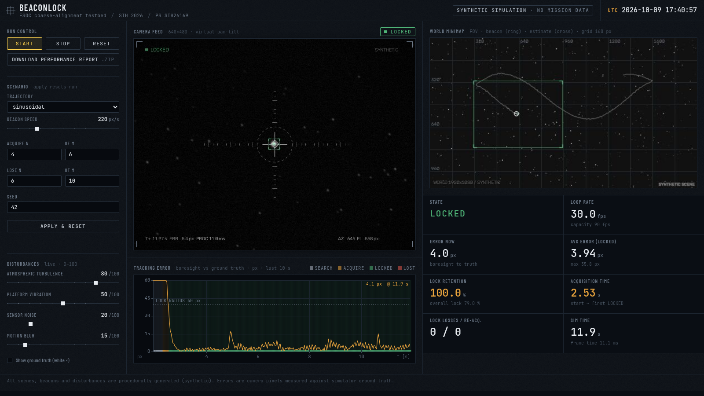

# BeaconLock

**Virtual testbed for the coarse-alignment stage of mobile Free Space Optical
Communication (FSOC) links.**
Smart India Hackathon 2026, Problem Statement **SIH26169 (ISRO)**.

> ⚠️ **All data is synthetic.** Every scene, star field, beacon, trajectory and
> disturbance here is procedurally generated. No real ISRO or mission data is
> used, reproduced or imitated. Frames carry a `SYNTHETIC` label, every config
> sets `"synthetic": true`, and every performance report says so.

## What it does

Pointing, Acquisition and Tracking (PAT) algorithms for laser links between
moving platforms (satellites, UAVs) normally need cameras, pan-tilt rigs and
optics. BeaconLock simulates the whole coarse-alignment loop in software:

1. A synthetic night-sky **world** (1920×1080) with stars, sensor noise and a
   moving optical **beacon** (linear, sinusoidal or random-waypoint path).
2. A **virtual pan-tilt camera** (640×480 viewport, slew-rate limited, clamped
   to the field of regard) that starts pointed away from the beacon.
3. **Disturbances**: Perlin-noise atmospheric turbulence (warp, beam wander,
   scintillation), platform vibration, motion blur and sensor noise, each 0–100.
4. **Detection → Kalman tracking → PID pointing**: a spiral search sweeps the
   sky, the detector finds the beacon, the N-of-M state machine confirms lock,
   and the controller keeps the beacon on the crosshair.
5. **Metrics** against simulator ground truth: acquisition time, tracking error
   (avg/RMS/p95/max px), lock retention %, FPS and per-frame time, exported as
   CSV plus an auto-generated summary.

**The demo:** press **Start**. The camera sweeps in a spiral, locks on in about
2.5 s, and holds the lock while turbulence shakes the image. The stats cards and
the downloadable report show the numbers.

## Quick start

```bash
# Windows (PowerShell / cmd)                 # macOS / Linux
py -3 -m venv .venv                          python3 -m venv .venv
.venv\Scripts\activate                       source .venv/bin/activate
pip install -r requirements.txt              pip install -r requirements.txt

python run.py            # -> prints  Dashboard: http://127.0.0.1:8000   (add --open to launch the browser)
```

Developer extras (tests and video export): `pip install -r requirements-dev.txt`.

| Command | What it does |
|---|---|
| `python run.py [--port 8000] [--open]` | Web dashboard on 127.0.0.1:8000 |
| `python scripts/run_headless.py` | 20 s closed-loop run with no UI; prints the summary and writes the report to `output/headless/` (exit code 0 only if LOCKED was reached) |
| `python scripts/run_headless.py --seconds 30 --turbulence 80 --video` | The same with stronger turbulence, plus an MP4 and GIF of the dashboard view |
| `python scripts/run_headless.py --trajectory random_waypoint --speed 400` | A different scenario |
| `python scripts/test_scene.py [--config configs/multi_beacon.json]` | Step-1 world render: 5 s MP4, GIF and keyframes |
| `python -m pytest -q` | Full test suite, including the end-to-end lock test |

Requires Python 3.10+. Everything runs offline after `pip install`: the
dashboard uses no CDNs, and the chart is drawn with a plain `<canvas>` in
vanilla JS. Fonts are bundled locally in `web/static/fonts` (Barlow Condensed
and JetBrains Mono, SIL Open Font License 1.1, license texts alongside), with
system fallbacks.

## Dashboard



* **Camera feed** (MJPEG, sensor-style vignette and scanlines): graduated
  reticle, dashed lock-radius ring, 1px tracking box with corner brackets,
  Kalman estimate (grey diamond), optional ground truth (white ×) and a
  lock-status tag: `IDLE / SEARCHING / ACQUIRING / LOCKED / LOST`.
* **World minimap**: 160 px graticule, FOV rectangle coloured by state,
  beacon, estimate and boresight trail.
* **Stat cards**: state, FPS (with processing capacity), current error, average
  and maximum locked error, lock retention %, acquisition time, lock losses and
  re-acquisitions, frame time.
* **Tracking-error graph**: last 10 s, background coloured by state, dashed lock-radius line.
* **Config panel**: trajectory, beacon speed, acquire/lose **N-of-M**
  thresholds, seed (*Apply & reset*); disturbance sliders apply **live**.
* **Start / Stop / Reset**, and **Download performance report**, a ZIP with
  `frames.csv`, `summary.txt`, `summary.json` and `config.json`.

## Architecture

```
beaconlock/
├── sim/                      # SIMULATION CORE: Python + NumPy + OpenCV, no web imports
│   ├── trajectories.py       # Trajectory base: Static, Linear (bounce|wrap), Sinusoidal (wrap|bounce|clip), RandomWaypoint
│   ├── scene.py              # Scene: world, stars, beacons, noise, ground truth, render_region()
│   ├── camera.py             # PanTiltCamera: viewport, pan/tilt/move/point_at, clamp, slew limit, get_frame()
│   ├── disturbances.py       # Perlin2D, Disturbances: turbulence, vibration, blur, noise (0-100 each)
│   ├── engine.py             # SimulationEngine: headless closed loop + build_config()
│   └── overlay.py            # OpenCV drawing shared by all front-ends (overlay, minimap, composite)
├── tracking/                 # VISION + CONTROL, no web imports
│   ├── detector.py           # BeaconDetector: blur, adaptive threshold, contours, weighted centroid (or None)
│   ├── tracker.py            # KalmanFilter2D, SpiralScan, BeaconTracker (N-of-M lock state machine)
│   └── controller.py         # PID (+ velocity feed-forward, anti-windup) -> pan/tilt commands
├── metrics.py                # MetricsRecorder: per-frame log, summary, CSV/TXT/JSON/ZIP export (no web imports)
├── web/                      # THIN UI LAYER: the only place FastAPI is imported
│   ├── runner.py             # SimRunner: real-time thread, JPEG rendering, settings validation
│   ├── app.py                # FastAPI routes (MJPEG feed, JSON state, config, report)
│   └── static/               # index.html, style.css, app.js (all local)
├── run.py                    # entry point: python run.py
├── configs/                  # default_scene.json, multi_beacon.json (scenes), demo.json (full engine config)
├── scripts/                  # test_scene.py (step 1 render), run_headless.py (end-to-end run)
└── tests/                    # pytest: trajectories, scene, camera, disturbances, tracking, metrics, engine E2E, web
```

`sim/`, `tracking/` and `metrics.py` never import a web framework, and a test
enforces it, so the same core can be wrapped in a desktop GUI and frozen with
PyInstaller. Asset paths go through `web.app.static_dir()`, which already
handles PyInstaller's `sys._MEIPASS`.

### The closed loop (one frame, `SimulationEngine.step`)

```
Scene.step(dt) → PanTiltCamera.get_frame() → Disturbances.apply() → BeaconDetector.detect()
  → BeaconTracker.update(meas_world, dt, boresight) → PanTiltController.update(error_px, dt, v_ff)
  → PanTiltCamera.move() (slew-limited) → MetricsRecorder.log(error vs ground truth)
```

Tracking runs in **world pixels**: boresight plus detection offset. Because the
gimbal encoders report the boresight, the Kalman filter is independent of the
camera's own motion. The controller turns the pixel error (aim point minus
boresight, i.e. the beacon's offset from the frame centre) into a pan/tilt rate,
using `rate = Kp·e + Ki·∫e + Kd·ė + Kff·v̂`.

### Lock state machine

```
IDLE --start--> SEARCHING --detection--> ACQUIRING --N_acq hits in M_acq & centred--> LOCKED
   SEARCHING <--too many misses-- ACQUIRING
   LOCKED --N_lose misses in M_lose--> LOST --detection near prediction--> ACQUIRING (re-acquire)
   LOST --lost_timeout_s--> SEARCHING (spiral around last estimate)
```

Defaults: acquire 4 of 6, lose 6 of 10, lock radius 40 px, coast 1.5 s. All are
configurable in `configs/demo.json` (`tracker` section) or the dashboard.

### Python API

```python
from sim.engine import SimulationEngine, build_config
eng = SimulationEngine(build_config("sinusoidal", speed=220,
                       disturbances={"turbulence": 60, "vibration": 30, "noise": 20, "blur": 15}))
summary = eng.run(seconds=20)            # starts the tracker, runs as fast as possible
print(eng.metrics.summary_text())
eng.write_report("output/my_run")        # CSV + summary.txt/json + config.json
```

Lower-level pieces: `Scene.from_json/from_dict`, `scene.step/render/render_region/ground_truth`,
`PanTiltCamera(scene, 640, 480, max_slew=1500).pan/tilt/move/get_frame`,
`Disturbances(DisturbanceConfig(turbulence=50)).apply(frame, t, cam_velocity)`,
`BeaconDetector().detect(frame) -> Detection | None`, `BeaconTracker`, `PanTiltController`, `MetricsRecorder`.

## Reference results (headless, demo config, 20 s, seed 42)

Disturbances at turbulence 40, vibration 30, noise 20, blur 15:
**acquisition 2.53 s**, **lock retention 100 %**, mean locked error about 3.3 px
(p95 about 6 px), 0 lock losses, about 10 ms per frame. At turbulence 100,
vibration 100, noise 100 and blur 100 it still locks: about 97–98 % retention
over 30 s, 2 brief losses, both re-acquired automatically. These are synthetic
results and depend on the seed and the disturbance settings.

## Model notes and limitations

* One world pixel equals one pixel of pan/tilt (unit IFOV, small-angle 2-D
  model). The disturbance models are qualitative, for exercising PAT logic; they
  are not calibrated to any real link.
* The camera is clamped to the world (field of regard). Trajectory margins of
  `[330, 250]` keep the beacon centrable for a 640×480 FOV.

## Packaging (planned)

The final deliverable is a standalone executable. The core is web-free, so
either `run.py` (bundling `web/static` as data) or a desktop GUI built on
`sim.engine` + `sim.overlay` can be frozen with PyInstaller, for example
`pyinstaller --onefile --add-data "web/static;web/static" run.py` on Windows
(use `:` instead of `;` on Linux/macOS).
