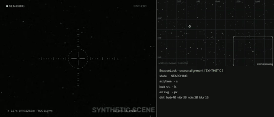
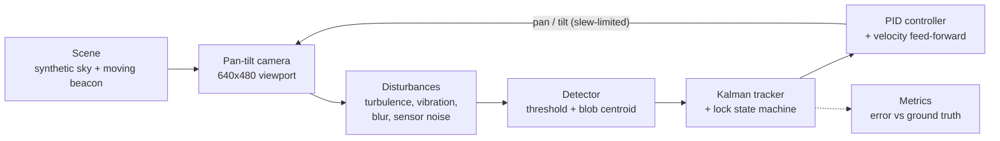
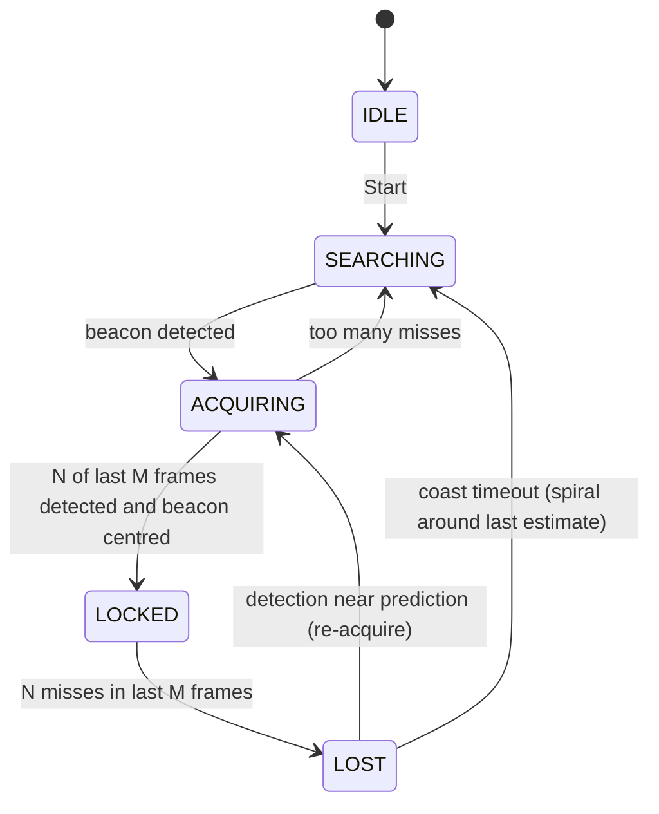

# BeaconLock

**A software testbed for the coarse-alignment stage of laser links between moving platforms. A virtual pan-tilt camera finds a moving optical beacon, locks on and holds it through simulated turbulence, and it reports how well it did.**


Built by **Team Sixfold404** for **Smart India Hackathon 2026**, problem statement **SIH26169 (ISRO)**.


> All scenes, beacons, disturbances and results in this repository are **synthetic**. Nothing here is real ISRO or mission data.

---

## The problem

Free Space Optical Communication (FSOC) sends data over a narrow laser beam. When both ends move (satellite to ground, UAV to UAV), the terminals first have to find each other and line up before any data flows. This coarse-alignment stage is called **pointing, acquisition and tracking (PAT)**. A camera scans for a beacon, locks onto it, and keeps it centred while the platforms move and the atmosphere distorts the image.

Testing PAT algorithms on hardware needs cameras, pan-tilt gimbals, optics and a lot of lab time. BeaconLock does the same loop entirely in software. You can try a detector, a filter or a controller, change the conditions, and get numbers back within seconds, on an ordinary laptop, offline.

## Demo



The camera starts pointed away from the beacon. It runs a spiral search, detects the beacon, confirms it over several frames, and locks. It then tracks the beacon's weaving path while turbulence, vibration, blur and sensor noise act on the image. The minimap on the right shows the whole world, the camera's field of view and the path it scanned.

## How it works

Every frame runs one closed loop:



1. **Scene.** A 1920×1080 night sky with stars, sensor noise and one or more beacons (bright Gaussian spots). A beacon moves on a straight line, a sinusoidal weave or random waypoints.
2. **Camera.** A 640×480 window into that world. It pans and tilts with a slew-rate limit, and it can't leave the world (the gimbal's field of regard).
3. **Disturbances**, each with a 0–100 slider:
   - Perlin-noise atmospheric turbulence (local warp, beam wander, scintillation)
   - sinusoidal platform vibration
   - motion blur along the slew direction
   - Gaussian sensor noise
4. **Detector.** A light blur, an adaptive threshold and contour detection give a sub-pixel centroid, or *nothing found*. Stars are rejected by size and brightness.
5. **Tracker.** A constant-velocity Kalman filter runs in world coordinates, so the camera's own motion doesn't confuse it. A state machine decides when the beacon is really acquired and when it's lost.
6. **Controller.** A PID on the pixel error (beacon offset from frame centre), plus feed-forward of the estimated beacon velocity. Its output is the pan/tilt command for the next frame.
7. **Metrics.** Every frame is logged against the simulator's ground truth, so the error numbers measure true pointing error rather than what the tracker *thinks* it is.

### Lock state machine



| Setting | Default | Meaning |
|---|---|---|
| Acquire N of M | 4 of 6 | Detections needed to confirm a lock |
| Lose N of M | 6 of 10 | Misses that drop a lock |
| Lock radius | 40 px | The beacon must also be this close to the crosshair to count as LOCKED |
| Coast timeout | 1.5 s | Time spent predicting in LOST before searching again |

You can change all of these from the dashboard or in `configs/demo.json`.

## Features

- Synthetic world generator: seeded star field, configurable beacons and trajectories, JSON configs, deterministic runs.
- Virtual pan-tilt camera with slew-rate limit and mechanical limits.
- Four independent image disturbances, each adjustable live from 0 to 100.
- Spiral search, N-of-M acquisition, Kalman tracking, coast-and-reacquire on loss.
- PID pointing with feed-forward, anti-windup and derivative filtering.
- Performance reports: acquisition time, average/RMS/p95/max error, lock retention, FPS and per-frame time. Exported as CSV, a text summary and JSON, all in one ZIP.
- Web dashboard:
  - live camera feed with reticle and tracking box
  - world minimap
  - error graph and stat cards
  - scenario and disturbance controls
  - one-click report download
- Headless CLI for repeatable runs, CI checks and MP4/GIF capture.
- The core (`sim/`, `tracking/`, `metrics.py`) never imports a web framework, so it can be wrapped in a desktop app.
- Runs fully offline. The dashboard bundles its own fonts and uses no CDNs.

## Results

All numbers come from **synthetic** runs with the default demo configuration (seed 42, sinusoidal beacon at 220 px/s, 30 Hz simulation). Errors are camera pixels between the boresight and the beacon's **ground-truth** position.

| Scenario | Result |
|---|---|
| Acquisition time (camera starts off-target) | **2.53 s** |
| Lock retention, 20 s, disturbances turbulence 40 / vibration 30 / noise 20 / blur 15 | **100 %** (0 lock losses) |
| Tracking error while locked, same run | **3.34 px** average, **5.9 px** p95 |
| Processing time, headless | **~10.5 ms per frame** (about **95 FPS**) |
| Dashboard loop rate | **30 FPS** (real time) |
| All four disturbances at 100, 30 s | **97.8 %** retention; 2 lock losses, both recovered automatically |
| Beacon speed 150–600 px/s, all three trajectory types, 20 s each | **100 %** retention in every run |
| Test suite | **84** pytest tests passing |

Timing depends on the machine. These were measured on a standard Linux dev box. The largest locked error (about 37 px) happens at the instant the beacon reverses direction at the edge of its path, before the Kalman velocity catches up.

## Quick start

You need Python 3.10 or newer.

**Windows (PowerShell or cmd)**

```bat
git clone https://github.com/KaustubhaKarthik-cloud/BeaconLock.git beaconlock
cd beaconlock
py -3 -m venv .venv
.venv\Scripts\activate
pip install -r requirements.txt
python run.py
```

**Linux / macOS**

```bash
git clone https://github.com/KaustubhaKarthik-cloud/BeaconLock.git beaconlock
cd beaconlock
python3 -m venv .venv
source .venv/bin/activate
pip install -r requirements.txt
python run.py
```

Open the address it prints, `http://127.0.0.1:8000`, and press **Start**. After installing, nothing else needs the internet.

## Usage

### Dashboard

```bash
python run.py              # http://127.0.0.1:8000
python run.py --open       # also opens your browser
python run.py --port 8080
```

- **Start / Stop / Reset** run, pause and restart the simulation.
- **Disturbance sliders** apply immediately, while the camera is tracking.
- **Scenario** settings (trajectory, beacon speed, N/M thresholds, seed) apply with **Apply & reset**.
- **Download performance report** returns a ZIP with `frames.csv`, `summary.txt`, `summary.json` and `config.json`.

### Headless CLI

```bash
python scripts/run_headless.py                                   # demo config, 20 s
python scripts/run_headless.py --seconds 30 --turbulence 80      # stronger turbulence
python scripts/run_headless.py --trajectory random_waypoint --speed 400
python scripts/run_headless.py --video                           # also writes MP4 + GIF
```

It prints the performance summary and writes the report to `output/headless/`. The exit code is `0` only if the beacon was acquired, so you can use it as a CI check. Other flags: `--vibration`, `--noise`, `--blur`, `--seed`, `--config`, `--out`.

To render the bare synthetic world without the camera (5 s MP4, GIF and keyframes):

```bash
python scripts/test_scene.py [--config configs/multi_beacon.json]
```

### Python API

```python
from sim.engine import SimulationEngine, build_config

engine = SimulationEngine(build_config("sinusoidal", speed=300,
                          disturbances={"turbulence": 60, "vibration": 30, "noise": 20, "blur": 15}))
summary = engine.run(seconds=20)
print(engine.metrics.summary_text())
engine.write_report("output/my_run")
```

## Project structure

```
beaconlock/
├── sim/                  simulation core (NumPy + OpenCV, no web imports)
│   ├── trajectories.py   beacon motion: static, linear, sinusoidal, random waypoint
│   ├── scene.py          synthetic world, stars, beacons, noise, ground truth
│   ├── camera.py         pan-tilt viewport with slew limit
│   ├── disturbances.py   turbulence, vibration, motion blur, sensor noise
│   ├── engine.py         the closed loop, headless
│   └── overlay.py        drawing shared by every front-end
├── tracking/             vision and control (no web imports)
│   ├── detector.py       threshold + contour beacon detector
│   ├── tracker.py        Kalman filter, spiral search, lock state machine
│   └── controller.py     PID with feed-forward
├── metrics.py            per-frame log, summary, CSV/JSON/ZIP export
├── web/                  thin FastAPI layer + local HTML/CSS/JS dashboard
├── run.py                dashboard entry point
├── scripts/              headless runner, scene renderer
├── configs/              demo and scene JSON configs
├── tests/                pytest suite
└── docs/                 README images
```

## Testing

```bash
pip install -r requirements-dev.txt
python -m pytest -q
```

The 84 tests cover:

- trajectories and scene rendering, including determinism
- camera limits, disturbances and the detector under noise
- Kalman convergence, every state-machine transition and PID behaviour
- metrics maths and the dashboard API
- end-to-end runs: the camera must start off-target, reach LOCKED with disturbances on, hold the lock, and recover after the beacon is hidden

One test also fails if a web framework is ever imported into the core.

## Roadmap

- **Standalone executable.** Package the app as a single `.exe` with PyInstaller. This is planned, not shipped yet. The core is already UI-independent, and the dashboard finds its assets inside a PyInstaller bundle.
- **Desktop front-end** on the same `sim.engine` + `sim.overlay` core.
- **Optional learned detector.** A small trained model as an alternative to the threshold detector, for harder scenes. This is a possible future addition.
- Angular units (IFOV in µrad) next to pixels, and more trajectory and disturbance models.

## About the data

Everything BeaconLock produces is generated by the simulator: the sky, the stars, the beacons, their paths, the disturbances, and therefore every result above. Frames are watermarked `SYNTHETIC`, configs carry `"synthetic": true`, and every report says so. The disturbance models are qualitative, meant to stress PAT logic; they are not calibrated against any real link.

## Team

**Team Sixfold404**, Smart India Hackathon 2026, problem statement SIH26169 (ISRO).

## License

[MIT](LICENSE) © 2026 Team Sixfold404.

The bundled fonts in `web/static/fonts` (Barlow Condensed, JetBrains Mono) are under the SIL Open Font License 1.1; their license texts are included.
